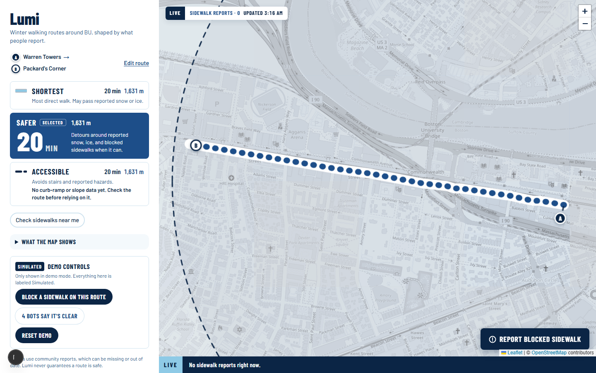
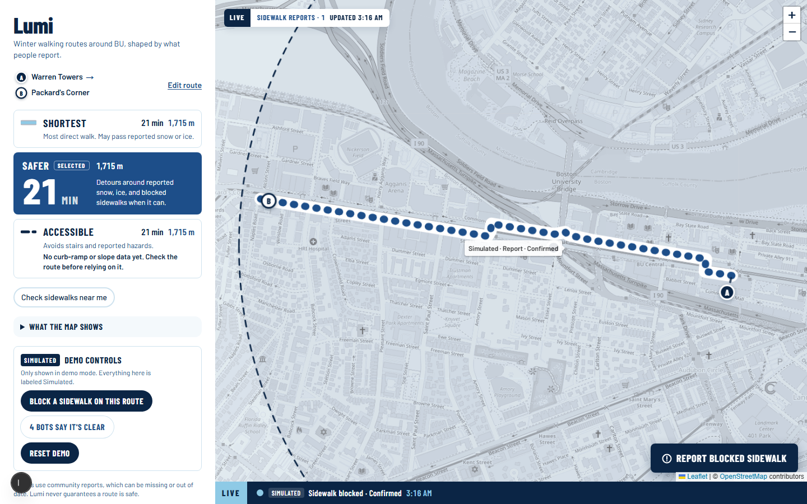

# Lumi

**Smarter paths. Safer winters.**

Winter walking navigation for Boston. Lumi recommends walking routes that account for reported snow, ice, and blocked sidewalks, not just distance. Built for HackBoston.

**Demo video:** see [docs/demo/README.md](docs/demo/README.md) for the latest recording and how to record it again.

> **Start here:** The [teammate handoff](docs/team/handoff.md) covers local setup, the simulated block-and-reopen flow, and what to verify on a phone. The app has report and vote endpoints, Clerk sign-in, and optional Tiger Data persistence.

## App screenshots

Captured from the Storm Center preview (PR #75), running locally with the BU street network. Both screenshots show Warren Towers to Packard's Corner.

**Route comparison before a report.** All three modes take the same 1,631 m path on this example.



**Detour after a simulated sidewalk block.** The route grows to 1,715 m, and the map and report strip label the blockage as simulated.



## Run the app

You need two terminals: one for the backend API, one for the map website. Both keep running until you stop them with **Ctrl+C**.

### Prerequisites (one-time)

- [uv](https://docs.astral.sh/uv/getting-started/installation/) for the Python backend. It installs Python 3.12 automatically.
- [Node.js](https://nodejs.org/) 22.18 or newer for the frontend and Mastra. Set up the frontend Clerk keys as described in the [handoff](docs/team/handoff.md).

Install the dependencies once after cloning:

```bash
cd backend
uv sync
cd ../frontend
npm install
```

### Terminal 1: backend API

```bash
cd backend
uv run uvicorn app.main:app --reload
```

The backend is ready when it prints `Uvicorn running on http://127.0.0.1:8000`. Loading the street map takes a few seconds. API docs: http://127.0.0.1:8000/docs

### Terminal 2: map website

```bash
cd frontend
npm run dev
```

The website is ready when it prints `Local: http://localhost:3000`.

### Use it

1. Open **http://localhost:3000**. Use `localhost`, not `127.0.0.1`; the backend only accepts requests from `localhost:3000`.
2. Click the map once to set your start, then again to set your destination. Stay inside the dashed circle.
3. The Shortest, Safer, and Accessible routes are drawn in different colors. Click a card or a line to see what that mode means.

Accessible avoids mapped stairs and may take a different route even before anyone reports a hazard.

### Troubleshooting

| Problem | Fix |
|---|---|
| "Can't reach the Lumi server" on the page | Terminal 1 isn't running or is still loading |
| "…outside Lumi's coverage area" | Click inside the dashed circle |
| `&&` errors in Windows PowerShell | Run the `cd` and the next command as separate lines |
| Path with spaces fails | Put the path in quotes: `cd "G:\some folder\Lumi\backend"` |
| Port already in use | Another copy is still running. Close it, or stop it with Ctrl+C |

### Secrets

Never commit keys. `.env` files and any file ending in `.env` are gitignored.

- **Backend:** database settings (`PG*`) and `LUMI_MASTRA_URL` go in `backend/.env`. Copy [backend/.env.example](backend/.env.example) and see [backend/README.md](backend/README.md).
- **Photo agent:** the Gemini key goes in `mastra/.env`. See [mastra/README.md](mastra/README.md).
- **Frontend:** the backend URL can be changed with `NEXT_PUBLIC_API_URL` in `frontend/.env.local`. The default is `http://127.0.0.1:8000`.

## What works today

- A walking network of 5,574 intersections and 14,936 sidewalk segments, within 1.5 km of Marsh Plaza (BU), from OpenStreetMap.
- `GET /route` with three modes: **shortest**, **safer**, **accessible**.
- Every mode skips segments reported fully blocked. Safer and Accessible also detour around milder hazards (snow, ice).
- Every response includes a plain-language explanation of what the chosen mode means.
- Points outside the coverage area are rejected with a clear message.

- A map website (`frontend/`) that draws all three routes between two clicked points.

Reports use in-memory storage by default. Configure Tiger Data to keep reports across backend restarts.

## API example

With the backend running, open http://127.0.0.1:8000/docs to try the API. Example, Marsh Plaza to Kenmore Square:

```
GET http://127.0.0.1:8000/route?start_lat=42.3504&start_lon=-71.1060&end_lat=42.3489&end_lon=-71.0951&mode=safer
```

Response:

```json
{
  "mode": "safer",
  "mode_description": "Safer: detours around reported snow, ice, ...",
  "distance_m": 951.7,
  "coordinates": [[42.3504, -71.1060], "..."],
  "hazards": []
}
```

| Status | Meaning |
|---|---|
| 200 | Route found. `hazards` lists anything reported on the segments it still uses. |
| 404 | No route avoids the blocked sidewalks. |
| 422 | Invalid input, or a point is outside the coverage area. |

### Tests

```bash
cd backend
uv run pytest
```

The tests use a tiny fake street network, so they run without the real map.

### Rebuild or resize the map

The coverage area is set in `backend/app/config.py` (`AREA_CENTER_LAT`, `AREA_CENTER_LON`, `AREA_RADIUS_M`). After changing it:

```bash
cd backend
uv run python scripts/build_graph.py
```

This downloads from OpenStreetMap and overwrites `backend/data/bu_walk.graphml`.

## How routing works

```
startup:  data/bu_walk.graphml ──load──> street graph in memory (never modified)
                                         hazards from confirmed reports

/route:   snap start/end to nearest intersection
          ──> Dijkstra with a weight function that combines graph + hazards ──> route
```

The street graph never changes. Hazard reports are kept separately, and a weight function combines the two on every request (`backend/app/routing.py`):

- **Blocked segment:** skipped by every mode.
- **Shortest:** cost = length.
- **Safer / Accessible:** cost = length × (1 + 4 × risk), where risk is the highest severity reported on that segment (0 to 1). The factor 4 is `SAFER_RISK_WEIGHT` in `config.py`, a starting value to tune.

Keeping all routing logic in that one function means adding modes or making old reports count less only changes one place.

## Project layout

```
backend/                 Python + FastAPI (details: backend/README.md)
  app/config.py          coverage area, file paths, tuning constants
  app/routing.py         modes, hazards, weight function, route search, point snapping
  app/reports.py         report rules (photo review, votes, 4-user flip)
  app/main.py            FastAPI app: routing, reporting, voting, and demo endpoints
  scripts/build_graph.py downloads the street graph
  data/bu_walk.graphml   the street graph (committed so nobody has to re-download)
  tests/                 routing, report, and API tests
frontend/                Next.js + TypeScript + Tailwind + Leaflet
  app/page.tsx           the page: click points, mode cards
  components/RouteMap.tsx the map and route lines
  lib/api.ts             calls the backend /route endpoint
docs/plans/              plan and open decisions for review
```

## Decisions so far

| Decision | Choice |
|---|---|
| Demo area | 1.5 km around Marsh Plaza; extend to all of Boston later |
| Backend | Python + FastAPI |
| Routing state | Street graph unchanged; hazards combined when each route is computed |
| Blocked segments | Skipped in every mode |
| Mode explanations | Shown to the user with every route |
| Hazard report storage | Tiger Data (managed PostgreSQL), with an in-memory fallback |

## Team docs

- [Teammate handoff](docs/team/handoff.md)
- [Open GitHub PRs and issues in plain language](docs/team/github-queue.md)
- [API contract](docs/team/api-contract.md)
- [Deployment checklist](docs/team/deploy.md)

## Known limitations

- **Report locations are self-reported (#60).** A report's or vote's location is whatever the phone sends, and the 50 m "nearby" check uses that same number. A photo can't prove where it was taken either. So four signed-in accounts could flip a sidewalk from anywhere, and one real photo of a blocked sidewalk could be sent for a different one. What limits this today:
  - sign-in is required;
  - each user can make at most 3 block attempts a day before they must send a photo;
  - photos are checked by the photo agent.

  None of that proves location. A real launch would add device attestation (App Attest / Play Integrity), limits per account per sidewalk, and a second person confirming before a photo blocks a sidewalk.
  **In the pitch, say it plainly:** "Locations come from the phone, so a determined person with several accounts could fake reports. For the hackathon we rely on sign-in, rate limits and photo checks; a launch would add device attestation and a second confirmation."
- Accessible mode has no curb ramp or slope data yet; it avoids mapped stairs and weighs hazards the same way Safer does.
- Points snap to the nearest intersection, not the nearest point along a sidewalk. The short stretch to that intersection isn't drawn.
- Never present a route as "safe": reports can be missing or out of date.
