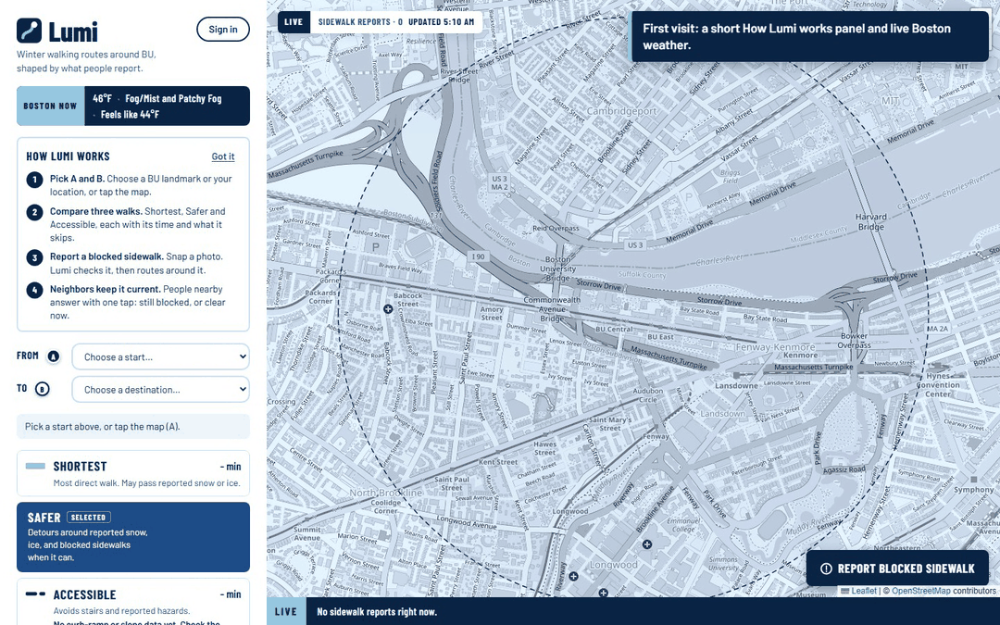

# Lumi demo video

The video itself is **not stored in git**: a 17 MB binary would stay in the repo's history forever, and every re-recording would add another. Recordings are uploaded as GitHub attachments or release assets and linked here.

**Latest recording:** not linked yet. The first take (44 s, 1440×900, captions, no sound, 2026-11-22) was made on unmerged UI and the BU Bridge → Kenmore route, so it should be re-recorded once the UI stack is on `main`, on the agreed demo route (Warren Towers → Packard's Corner, see #8 and `docs/team/demo-script.md`).



## What the first take showed

1. The first screen: live Boston weather and the How Lumi works panel.
2. BU Bridge → Kenmore Square: 1,639 m, about a mile.
3. The three route modes (Shortest, Safer, Accessible), each with its meaning.
4. A simulated blocked sidewalk. A blocked sidewalk is skipped by **every** mode, so all three redraw around it (1,667 m), and the report shows on the map and in the live strip, labeled Simulated.
5. Four simulated people say it's clear, and the route returns to 1,639 m.

Everything in it is demo data from the `/demo` endpoints, labeled **Simulated** on screen. Reports were kept in memory, not in the database.

## Which version this is

It was recorded from the Storm Center redesign plus the frontend additions, which aren't on `main` yet:

- the UI stack: #64, #69, #70, #71, #75;
- #89 (weather, route insight, How Lumi works, logo);
- #77 (Clerk v7), applied locally.

## Record it again

`record.js` drives a headless Chromium with Playwright and saves a `.webm`.

1. Start the backend in demo mode, keeping reports in memory (no `--env-file`):
   ```bash
   cd backend
   LUMI_DEMO_MODE=1 LUMI_FRONTEND_ORIGINS=http://localhost:3300 uv run uvicorn app.main:app --port 8100
   ```
2. Build and start the frontend against it:
   ```bash
   cd frontend
   NEXT_PUBLIC_API_URL=http://127.0.0.1:8100 npm run build
   npx next start -p 3300
   ```
3. In an empty folder: `npm i playwright`, `npx playwright install chromium ffmpeg`, copy `record.js` there, and run `node record.js`. The video lands in `video/`. Upload it (drag it into a GitHub comment, or attach it to a release) and link it above; don't commit it.

The ports are 3300 and 8100 so a normal dev setup on 3000 and 8000 can keep running. The script resets the demo first. It waits for the page content, not for the network to go quiet: Clerk's background check can hang for about 20 s on some networks.
